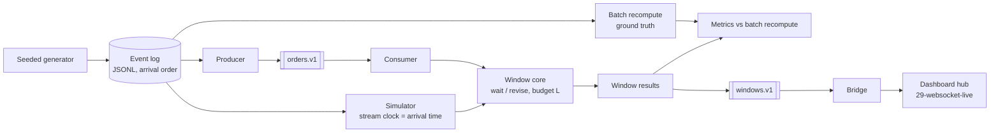

# streaming-pipeline

> An order stream aggregated into 60-second windows per zone, with a measured answer to the
> question every streaming job has to settle: how long to wait for late events.

**Live demo:** not deployed. It runs locally (simulator, or Redpanda in Docker).
**Stack:** Python 3.13 · a hand-written windowing core (stdlib only) · Redpanda (Kafka API) ·
confluent-kafka at the edge only · pytest · ruff · uv

---

## 1. The problem

A batch mart answers yesterday's question. A stream answers "how many orders per zone in the last
minute", but events arrive late and out of order, so every window result is a bet on how long to
wait. Wait longer and the number is complete but stale. Answer early and it is fresh but may be
wrong. This project measures that bet instead of hiding it behind a framework default.

Two emission policies share one windowing core and one lateness budget `L`:

- **wait**: answer once, `L` seconds after the window ends (in event time), and drop anything later.
- **revise**: answer as soon as the window ends, then send a corrected result for each late event,
  until the same `L` runs out.

Both accept exactly the same events, so their final answers are identical by construction (a tested
invariant). What differs is when the first answer goes out, how often it is wrong, and how much
correction traffic it costs downstream.

## 2. The data

| | |
|---|---|
| Source | Synthetic order events from a seeded generator (`src/streampipe/events.py`) |
| Size | about 20,700 events per run (3,600 s of event time, 6 zones); 45 logs in the sweep |
| Licence | Generated; MIT with the repo |
| Lateness model | 0 / 5 / 20 % of events are "late", delayed uniformly up to 5 / 30 / 120 s; the rest arrive within 2 s |

The lateness model is an assumption of the generator, not a property of real order systems. Real
delays are usually heavy-tailed and correlated (a phone loses signal and replays an hour of events),
which this generator does not model. Every number in §5 is a property of this generator.

## 3. Architecture



- **`windows.py`**: tumbling windows keyed by `(zone, window_start)`. With `M` the latest event
  time seen, a window is *due* at `M >= end` and *closed* at `M >= end + L`. Events for a closed
  window are dropped and counted. Wait emits once at close; revise emits at due, on each late event,
  and a final record at close. Firing uses heaps ordered by window end, so it costs nothing per event.
- **`sim.py` + `metrics.py` + `evalrun.py`**: replay a log with the arrival time as the clock, score
  every window against a batch group-by of the same log, and run the pre-registered grid.
- **`kafka_io.py` + `bridge.py`**: the same core behind a Redpanda topic, and a bridge that posts
  results to the WebSocket hub from `29-websocket-live` (`POST /publish/windows`). The broker path
  is a correctness check; latency comes from the simulator ([docs/kafka.md](docs/kafka.md)).

## 4. Key decisions & tradeoffs

| Decision | Chose | Over | Why |
|---|---|---|---|
| Windowing engine | Hand-written core, Kafka client only at the edge | Flink, Bytewax, Quix Streams | The result depends on exact watermark and lateness semantics. Owning them makes them testable without a broker and explainable line by line |
| Meaning of `L` | One acceptance horizon (`M < end + L`) shared by both policies | `L` as watermark delay in one mode and grace period in the other | If `L` means two things, "revise is faster" partly measures a different budget. With one meaning, the policies differ only in when they speak |
| Ground truth | Batch recompute of the same log | Comparing the two policies to each other | Each policy is scored against an independent oracle, so "exact" means equal to what a batch job would say |
| Money | Integer cents | Float sums | Stream and batch add in different orders, and float sums would make "exact" depend on order |
| Clock | Stream time (arrival time) in the simulator; max event time on the broker | Wall clock | Results are deterministic and machine-independent; a sweep rerun is byte-identical |
| Broker | Redpanda single node, 1 partition | Kafka KRaft; several partitions | One binary for local work. One partition gives one total order, so the broker run reproduces the simulator |
| Evaluation | Claim frozen in [EVAL_PLAN.md](EVAL_PLAN.md) before any sweep code | Picking `L` after seeing the curve | The plan fixes the grid, metrics, exclusions and pass rule, and `evalrun` checks the claim mechanically |

## 5. Results

All numbers come from [`results/REPORT.md`](results/REPORT.md), which `streampipe report`
generates from the committed sweep files. The sweep ran 450 runs: 3 late shares × 3 max delays ×
5 values of `L` × 2 modes × 5 seeds. Each run is 3,600 s of event time and about 20,700 events, and
the data is synthetic (§2). Latencies are in stream seconds, pooled over the 5 seeds. A rerun from a
fresh clone is byte-identical.

**The claim.** The pre-registered claim turned out to be true by construction, which a review caught
before the run (delay ≤ 30 s and `L = 30` means nothing can be dropped). It is kept as a construction
check, and it passed. The plan was then amended, before any data, to a falsifiable claim. An analytic
model of the generator ([ANALYTIC.md](ANALYTIC.md)) predicts six things, frozen in
`results/predictions.json` with exact acceptance regions and a pinned hash:
- the event count;
- the drop rate;
- revise's first-answer exactness;
- wait's final exactness;
- first-emit latency;
- the wait = revise invariants.

| Claim | Result |
|---|---|
| C0, construction check: wait, `L = 30`, 5 % late, ≤ 30 s: exact ≥ 99 %, first-emit p95 ≤ 90 s | passed (100 %, 31.6 s), as it must |
| Primary: the analytic model predicts the core (P0–P4 + invariants) | **passed, 369 / 369 checks** (about 50–55 independent tests; false-failure risk if the model is right ≈ 0.5 %) |

**Wait vs revise at equal `L`** (5 % late, delays up to 30 s; the baseline is `L = 0`):

| `L` | First answer p95, wait | First answer p95, revise | First answer exact, wait | First answer exact, revise | Events dropped | Corrections per window, revise | Records per run, wait / revise |
|---|---|---|---|---|---|---|---|
| 0 | 1.5 s | 1.5 s | 39.9 % | 39.9 % | 1.6 % | 0.00 | 360 / 360 |
| 5 | 6.5 s | 1.5 s | 66.6 % | 39.9 % | 0.7 % | 0.51 | 360 / 897 |
| 15 | 16.6 s | 1.5 s | 87.6 % | 39.9 % | 0.2 % | 0.78 | 360 / 996 |
| 30 | 31.6 s | 1.5 s | 100.0 % | 39.9 % | 0.0 % | 0.92 | 360 / 1,044 |

In wait mode the first answer is the final answer. Final accuracy is identical for both policies by
construction.

**What it shows.**
- **Revise's early answer is mostly wrong, and `L` cannot fix that.** It goes out 1.5 s after the
  window ends at every `L`. That is 30 s sooner than wait at `L = 30`, but at 5 % late it is exact for
  only 39.9 % of windows, and the rate does not change with `L`. A bigger budget buys more
  corrections (0.92 per window at `L = 30`), not a better first answer.
- **Even with zero late events, 27 % of early answers are wrong.** Network jitter of only 0–2 s
  carries events across the window end. Revise's first answer is exact for 72.9 % of windows at 0 %
  late, while wait with `L ≥ 5` is 100 %.
- **Waiting is cheap when the delay bound is known.** At 5 % late with delays up to 30 s, `L = 30`
  gives 100 % exact windows 31.6 s after the window ends, in one record per window. Revise sends
  2.9× the records to end at the same values.
- **When delays exceed the budget, both policies fail together.** In the stress regime (20 % late,
  up to 120 s), the results by `L` are:

  | `L` | Events dropped | Count error per window | Windows exact | Corrections per window, revise |
  |---|---|---|---|---|
  | 0 | 15.0 % | 8.74 | 0.0 % | 0.00 |
  | 60 | 4.4 % | 2.63 | 8.3 % | 6.06 (8× wait's records) |

  Neither policy recovers what the budget drops.

**Limits.**
- Every number is a property of this generator: uniform delays, independent lateness, one rate
  profile. The model and the simulator share that assumption, so passing the claim shows the core
  does what its semantics say. It says nothing about real order streams.
- Rows with 0 % late share are identical across max delay. Cells within a seed share the same
  events, so they are paired, not independent.
- The broker path is a correctness gate, not a source of latency or throughput numbers. Through
  Redpanda, two registered-scale logs (one with 12 % of events dropped) gave the same records, in
  order, as the simulator in both modes. No message was lost or duplicated, checked against the
  broker's partition offsets ([docs/kafka.md](docs/kafka.md#broker-check-2026-10-23),
  `results/broker_check.json`).

## 6. How to run

Prerequisites: [uv](https://docs.astral.sh/uv/). Docker Desktop only for the broker path.

```bash
git clone https://github.com/Prithv122/streaming-pipeline.git
cd streaming-pipeline
uv sync
uv run pytest -m "not integration"
```

Simulator path (no broker):

```bash
uv run streampipe gen --seed 0 --late-share 0.05 --max-delay 30 --out data/events/s0.jsonl
uv run streampipe replay --log data/events/s0.jsonl --mode revise --lateness 30
uv run streampipe predict          # recompute the analytic predictions (about 1 min); compare with results/predictions.json
uv run streampipe sweep            # the registered 450-run grid (about 1 min); refuses to run if the predictions hash does not match the pin
uv run streampipe report           # regenerate results/REPORT.md from the sweep files
```

The sweep is deterministic: a rerun writes byte-identical `results/sweep*.csv` and `sweep_claim.json`.

Broker path (Redpanda in Docker, see [docs/kafka.md](docs/kafka.md)):

```bash
docker compose up -d
uv sync --extra kafka
uv run streampipe produce --log data/events/s0.jsonl
uv run streampipe consume --mode revise --lateness 30
uv run pytest -m integration
uv run python scripts/verify_broker.py   # the broker gate: about 70 s, writes results/broker_check.json
docker compose down
```

`PUBLISH_TOKEN` is the only environment variable, and it is optional. Set it when the bridge posts
to a dashboard hub that requires a bearer token.

## 7. What I'd change at 100× scale

- **One partition is the first thing to break.** Ordering across zones comes from a single
  partition. At scale the topic is partitioned by zone, each partition keeps its own watermark, and
  the job's watermark is the minimum across partitions. An idle partition then stalls every window,
  so it needs idle-source detection.
- **State has to survive a restart.** Window state lives in a dict. A crash loses open windows,
  and a replay from the committed offset double-counts. The fix is checkpointed state plus
  transactional output (or idempotent downstream upserts keyed by `(zone, window_start, revision)`).
- **Revision traffic multiplies with fan-out.** Revise mode sends extra records per window to every
  consumer. With many subscribers, the hub should coalesce revisions per window, or only push
  revisions that change the displayed number.
- **The lateness model must come from data.** At scale, `L` should come from the observed delay
  distribution per source (for example the 99.9th percentile of `arrival − event time`), monitored
  for drift, not from a constant.

---

## References

- Akidau et al., *The Dataflow Model* (VLDB 2015): watermarks, allowed lateness and accumulating
  panes. Revise mode here is a minimal accumulating-pane policy.
- Apache Flink documentation, *Allowed Lateness*: the semantics this core's revise mode mirrors.
